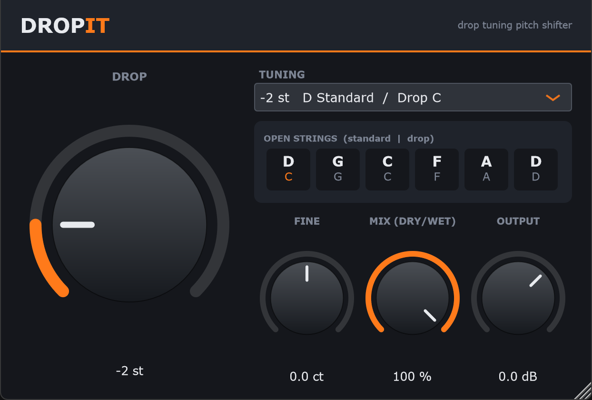

# DropIt: Drop-Tuning Pitch Shifter (VST3)

DropIt is a C++ audio plugin, built with [JUCE](https://juce.com), that lowers the pitch of whatever you feed it. With it you can play
a guitar in standard tuning and hear it in D standard, C standard, Drop C, and so on, without retuning.



## Features

| Control | Range | What it does |
|---|---|---|
| **Drop** (big knob) | 0 to −12 semitones | How far the pitch is lowered, in whole semitones. Double-click to reset to −2. |
| **Tuning** (drop-down) | 13 presets | The same parameter shown by name, e.g. `-2 st  D Standard / Drop C`. Picking a preset moves the knob, and turning the knob updates the preset. |
| **Open strings** display | n/a | Shows the six open-string notes after the drop. The top row assumes you are in E standard, the bottom row assumes Drop D. |
| **Fine** | −50 to +50 cents | Fine trim, e.g. to match a band that tunes to A=432 Hz or a slightly detuned record. Double-click resets to 0. |
| **Mix (dry/wet)** | 0 to 100 % | 0 % is only the original signal, 100 % is only the dropped signal, and values in between blend the two (equal-power blend). The original signal is delayed to match the shifter, so the two stay in time. |
| **Output** | −24 to +12 dB | Output level trim. |

Other details:

* Mono and stereo, at any sample rate. The stereo image is preserved.
* Every parameter can be automated and is saved with your DAW project.
* The window can be resized (drag the bottom-right corner).
* Builds **VST3** and a **Standalone** app on all platforms, plus **AU** on macOS.

### Which preset do I want?

The plugin shifts the *whole* signal down, so every string moves by the same amount:

| Drop | If your guitar is in **E standard** you hear… | If your guitar is in **Drop D** you hear… |
|---|---|---|
| −1 | Eb standard | Drop C# |
| −2 | D standard | Drop C |
| −3 | C# standard | Drop B |
| −4 | C standard | Drop A# |
| −5 | B standard | Drop A |
| −7 | A standard | Drop G |
| −12 | E standard, one octave down | Drop D, one octave down |

> **Note:** DropIt cannot turn E standard into *Drop D* by itself, because that needs only the low E string lowered.
> No pitch shifter can pull one string out of a mixed guitar signal. Tune your low E down to D on the guitar,
> then use DropIt to go further (Drop C, Drop B, …).

---

## How it works (DSP)

The pitch shifter is in [Source/PitchShifter.h](Source/PitchShifter.h). It needs no libraries beyond JUCE.

1. Incoming audio is written into a circular delay buffer.
2. A read head plays that buffer back at `ratio = 2^(semitones/12)` speed, which is slower than real time, so
   the pitch is lower. Because the read head falls further and further behind, it has to jump forward every so often.
3. Before each jump, the shifter searches about 15 ms of candidate positions. It picks the one whose waveform best
   matches the current one, using normalised cross-correlation on the mono sum. Then it does a 10 ms raised-cosine crossfade
   to that position. Lining up the waveforms this way avoids the warble and pitch error that a plain two-tap
   delay-line shifter has on low notes.
4. Reads use 4-point Hermite interpolation. Pitch changes are smoothed so knob moves don't click.
5. At exactly 0 semitones the shifter crossfades to a plain delayed copy of the input, so there is no comb filtering.

**Latency** is about **29 ms** (around 1,380 samples at 48 kHz). The plugin reports this to the host, so DAWs with
plugin delay compensation keep it in time with your other tracks. When you monitor live while recording, you will hear
that delay. Most players don't notice it, but use direct monitoring of the dry signal if it bothers you.

Accuracy was checked offline with sine waves from 82 Hz (low E) to 1 kHz at drops of 0, −1, −2, −5 and −12 semitones.
The output frequency matched the expected value within the 0.25 Hz resolution of the measurement.

---

## 1. Install the dependencies

You need **a C++17 compiler, CMake ≥ 3.22, and Git**. JUCE itself is downloaded for you by the setup script, or
by CMake if you skip the script.

### Windows 10 / 11

1. **Visual Studio 2022** (Community is free) or **Build Tools for Visual Studio 2022**, with the
   **"Desktop development with C++"** workload. Easiest from a terminal:
   ```powershell
   winget install --id Microsoft.VisualStudio.2022.BuildTools -e --override "--add Microsoft.VisualStudio.Workload.VCTools --includeRecommended --passive"
   ```
   You can also download it from <https://visualstudio.microsoft.com/downloads/> and tick *Desktop development with C++*
   in the installer.
2. **CMake** 3.22 or newer:
   ```powershell
   winget install --id Kitware.CMake -e
   ```
3. **Git**:
   ```powershell
   winget install --id Git.Git -e
   ```
4. **Close and reopen your terminal** so the new tools are on `PATH`.

> **Visual Studio 2026 (version 18):** CMake added support for VS 2026 in version 4.2. With an older CMake,
> CMake automatically uses VS 2022 if that is also installed. Otherwise upgrade CMake, or build with Ninja from a
> *Developer PowerShell* (see [Building manually](#building-manually)).

### macOS (12 Monterey or newer)

```bash
xcode-select --install          # Apple's compiler + command line tools
/bin/bash -c "$(curl -fsSL https://raw.githubusercontent.com/Homebrew/install/HEAD/install.sh)"  # Homebrew, if missing
brew install cmake git ninja    # ninja is optional but builds faster
```

### Linux

JUCE needs the ALSA, X11, FreeType and font development headers. `./scripts/setup.sh --install-deps` installs these
for you on apt, dnf and pacman systems. To install them by hand instead:

**Debian / Ubuntu / Mint / Pop!_OS**
```bash
sudo apt update
sudo apt install build-essential cmake git pkg-config ninja-build \
  libasound2-dev libjack-jackd2-dev ladspa-sdk libcurl4-openssl-dev \
  libfreetype-dev libfontconfig1-dev libx11-dev libxcomposite-dev libxcursor-dev \
  libxext-dev libxinerama-dev libxrandr-dev libxrender-dev libgl1-mesa-dev
```
(On older Ubuntu releases use `libfreetype6-dev` instead of `libfreetype-dev`.)

**Fedora**
```bash
sudo dnf install gcc-c++ make cmake git pkgconf-pkg-config ninja-build alsa-lib-devel \
  jack-audio-connection-kit-devel freetype-devel fontconfig-devel libX11-devel libXcomposite-devel \
  libXcursor-devel libXext-devel libXinerama-devel libXrandr-devel libXrender-devel mesa-libGL-devel libcurl-devel
```

**Arch / Manjaro**
```bash
sudo pacman -S --needed base-devel cmake git pkgconf ninja alsa-lib jack2 freetype2 fontconfig \
  libx11 libxcomposite libxcursor libxext libxinerama libxrandr libxrender mesa curl
```

---

## 2. Set up and build

### Windows (PowerShell)

```powershell
cd path\to\DropIt
powershell -ExecutionPolicy Bypass -File scripts\setup.ps1     # checks tools, downloads JUCE 8.0.9 to external\JUCE
powershell -ExecutionPolicy Bypass -File scripts\build.ps1     # Release build
```

`build.ps1` options:

| Option | Meaning |
|---|---|
| `-Config Debug` | Debug build (default `Release`). |
| `-Clean` | Delete `build\` first. |
| `-Install` | Copy `DropIt.vst3` into a VST3 folder (see [Installing the plugin](#3-install-the-plugin)). |
| `-Generator "Ninja"` | Choose a CMake generator. Default: newest Visual Studio CMake knows. |

### macOS / Linux (bash)

```bash
cd path/to/DropIt
chmod +x scripts/*.sh
./scripts/setup.sh              # add --install-deps on Linux to apt/dnf/pacman install the packages
./scripts/build.sh              # Release build
```

`build.sh` options: `--debug`, `--clean`, `--install`.

`setup.sh` accepts `JUCE_TAG=<tag>` to pick another JUCE version, e.g. `JUCE_TAG=8.0.8 ./scripts/setup.sh`.

### Build output

```
build/DropIt_artefacts/Release/
├── VST3/DropIt.vst3          ← the plugin
├── Standalone/DropIt(.exe/.app)
└── AU/DropIt.component        (macOS only)
```

The first build compiles JUCE and takes a few minutes. Later builds are incremental.

### Building manually

If you'd rather not use the scripts:

```bash
git clone --depth 1 --branch 8.0.9 https://github.com/juce-framework/JUCE.git external/JUCE   # optional
cmake -S . -B build -DCMAKE_BUILD_TYPE=Release        # add -G Ninja, or -A x64 for Visual Studio
cmake --build build --config Release --parallel
```

CMake looks for JUCE in this order:
1. `external/JUCE` (what the setup scripts create)
2. `-DJUCE_DIR=/path/to/your/JUCE` (an existing checkout)
3. Otherwise it downloads JUCE `8.0.9` itself with FetchContent. Change the version with `-DDROPIT_JUCE_TAG=<tag>`.

Add `-DDROPIT_COPY_AFTER_BUILD=ON` to have JUCE copy the plugin into the system plugin folder after every build.
On Windows that needs an Administrator terminal.

To open the project in an IDE: on Windows open `build/DropIt.sln` in Visual Studio. On macOS, generate an Xcode project with
`cmake -S . -B build-xcode -G Xcode` and open `build-xcode/DropIt.xcodeproj`.

---

## 3. Install the plugin

The `-Install` / `--install` flag does this for you. To copy it by hand:

| OS | Copy `DropIt.vst3` to | Notes |
|---|---|---|
| Windows | `C:\Program Files\Common Files\VST3\` | Needs Administrator. Without admin, the script uses the per-user folder `%LOCALAPPDATA%\Programs\Common\VST3\`. Some hosts (e.g. Reaper, Bitwig, FL Studio) scan that folder; for others, add it to the plugin search paths. |
| macOS | `~/Library/Audio/Plug-Ins/VST3/` | Copy `DropIt.component` to `~/Library/Audio/Plug-Ins/Components/` for Logic / GarageBand. |
| Linux | `~/.vst3/` | Or `/usr/lib/vst3/` system-wide. |

Then **rescan plugins** in your DAW. DropIt appears under the manufacturer **DropIt Audio**, category *Pitch Shift*.

### Trying it without a DAW

Run the standalone app (`build/DropIt_artefacts/Release/Standalone/DropIt.exe` or `DropIt.app`). Click **Options →
Audio/MIDI Settings**, choose your audio interface, and pick the input your guitar is plugged into. The standalone mutes
input by default to avoid a feedback loop through speakers. Use headphones and untick *Mute audio input*.

---

## Project layout

```
DropIt/
├── CMakeLists.txt            build definition (JUCE plugin target)
├── Source/
│   ├── PitchShifter.h        the DSP: correlation-spliced delay-line pitch shifter
│   ├── PluginProcessor.*     parameters, dry/wet mixer, output gain, state save/load
│   └── PluginEditor.*        GUI: custom knobs, tuning presets, open-string display
├── scripts/
│   ├── setup.ps1 / setup.sh  check prerequisites + fetch JUCE
│   └── build.ps1 / build.sh  configure, build and optionally install
└── external/JUCE/            (created by setup, git-ignored)
```

---

## Troubleshooting

| Problem | Fix |
|---|---|
| `running scripts is disabled on this system` | Run the scripts as shown, with `powershell -ExecutionPolicy Bypass -File …`. |
| `cmake` / `git` not recognised after installing | Open a new terminal so `PATH` is refreshed. |
| `No CMAKE_CXX_COMPILER could be found` (Windows) | The *Desktop development with C++* workload isn't installed. Rerun the Visual Studio Installer and add it. |
| `Generator Visual Studio 18 2026 could not find any instance` / VS 2026 not detected | Upgrade CMake to ≥ 4.2, install VS 2022 alongside it, or open *Developer PowerShell for VS* and run `scripts\build.ps1 -Generator Ninja`. |
| `Error: generator platform: x64 does not match the platform used previously` | Run the build script with `-Clean` (or delete `build/`). |
| Linux: `Package alsa was not found` / missing X11 headers | Install the packages listed in [Linux](#linux), or run `./scripts/setup.sh --install-deps`. |
| macOS: plugin doesn't show up in Logic | Run `killall -9 AudioComponentRegistrar`, then rescan in Logic's Plug-in Manager. |
| macOS: "DropIt can't be opened" | The local build isn't notarised. Run `xattr -dr com.apple.quarantine ~/Library/Audio/Plug-Ins/VST3/DropIt.vst3`. |
| Sound is "doubled" or chorus-like | Mix is below 100 %, so you're hearing both the original and the dropped signal. Turn Mix to 100 % for a pure drop. |
| Hearing a small delay while tracking | That's the ~29 ms shifter latency. See [How it works](#how-it-works-dsp). |

---

## Licensing

DropIt's own source is yours to license as you like. It is built on **JUCE 8**, which is dual-licensed under
**AGPLv3** or a commercial JUCE licence (free *Starter* tier for small revenue). To distribute binaries, either
release your code under AGPLv3 or get a JUCE licence. JUCE bundles the Steinberg VST3 SDK. Check the licence file
in `external/JUCE/modules/juce_audio_processors/format_types/VST3_SDK/` for the version you build with.
VST is a registered trademark of Steinberg Media Technologies GmbH.
